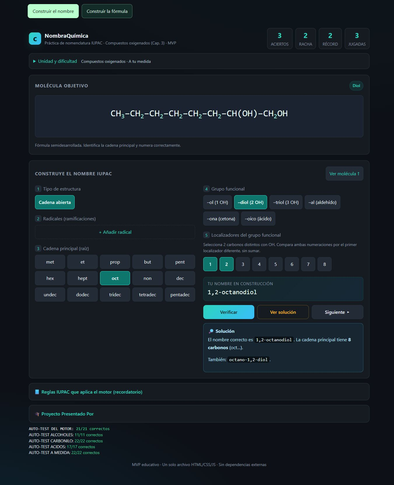
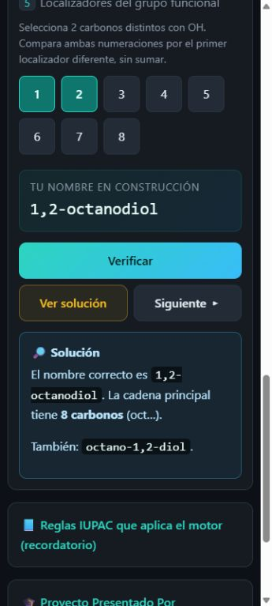
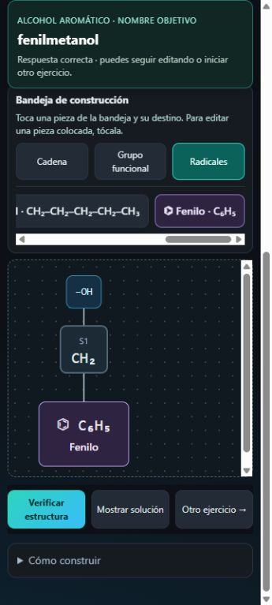
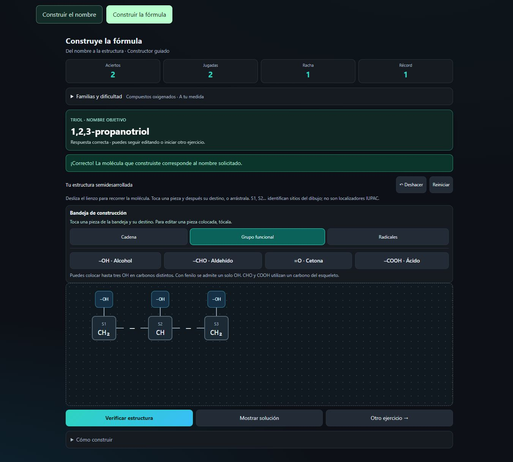
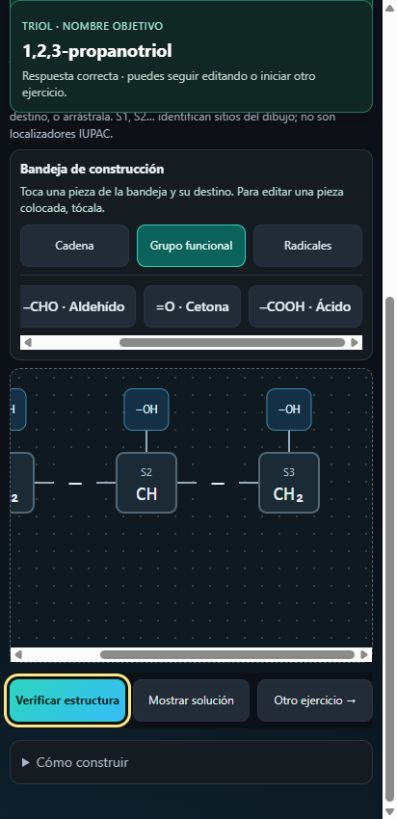

# Verificación de polioles y alcoholes aromáticos

Fecha: 18 de octubre de 2026. Base: `main` (`d71be40`).

## Pruebas automáticas

Ejecutado con Node.js, sin instalar dependencias:

```text
node --test tests/formula.test.cjs tests/name-layout.test.cjs tests/alcohols.test.cjs
91 pruebas aprobadas; 0 fallos, 0 omitidas.
```

Se conservan sin cambios las 61 pruebas anteriores: incluyen las 93 comprobaciones del motor y 600 objetivos de las diez familias originales. Las 30 pruebas nuevas comprueban:

- 200 objetivos con semilla fija por combinación diol/triol y complejidad: 1.200 polioles.
- 100 objetivos aromáticos por complejidad: 300 objetivos y comprobación de ambos ejemplos en cada perfil.
- Etanodiol, ambos propanodioles, glicerol, fenilmetanol y 2-feniletanol: nombre, alternativas documentadas, carbonos, hidrógenos y oxígenos.
- Inversión de cadena, otro recorrido válido, posiciones y número de OH, expansión aromática y distinción entre los isómeros α y β.
- Rechazo de OH geminales, cuatro OH, funciones mixtas, fenoles y varios fenilos.
- Respaldo forzado dentro de la familia y perfil, preferencias antiguas y nuevas, historial, puntuación única y selección múltiple de localizadores.
- Consulta de equivalencias después de acertar sin volver a contar ni alterar la racha.

## Revisión en navegador

Navegador integrado basado en Chromium. Se probaron anchos de 320, 360, 412, 640, 1024 y 1366 px; el caso de 640 px usó altura de 360 px.

En ambos modos la página completa quedó dentro del ancho disponible. Las fórmulas largas conservaron 24 px en pantallas pequeñas y 32 px en escritorio, con desplazamiento en el visor molecular. El fenilo y los OH individuales fueron visibles y accesibles en su lienzo.

Se resolvieron nombres de dioles y fenilmetanol, incluidos localizadores mediante teclado y equivalencias después del acierto. Se construyeron fenilmetanol y glicerol: OH por arrastre de puntero y por selección seguida de clic, fenilo por selección y colocación, edición individual, movimiento y dos acciones de Deshacer. La corrección posterior conservó el recuento único. Escape canceló la selección. Alternar los modos conservó ejercicio, respuesta y marcadores independientes. No se observaron errores ni advertencias de consola.

Las dimensiones móviles son una simulación de tamaño de ventana. **Quedan pendientes las pruebas en Android/Chrome y Safari/iOS físicos**, incluidos arrastre táctil, desplazamiento automático durante el arrastre, cancelación del sistema y zoom por gesto. Esta revisión no afirma haberlas realizado.

## Capturas

| Nombres | Fórmulas |
|---|---|
|  |  |
|  |  |
| |  |
| |  |

## Convenciones

La respuesta principal conserva la nomenclatura escolar del proyecto. Las soluciones muestran equivalencias modernas y los nombres comunes documentados. La comparación de localizadores de OH usa el primer punto de diferencia, conforme a la sección de [compuestos hidroxilados del Blue Book de IUPAC](https://iupac.qmul.ac.uk/BlueBook/P6.html#P-63.1.2).
