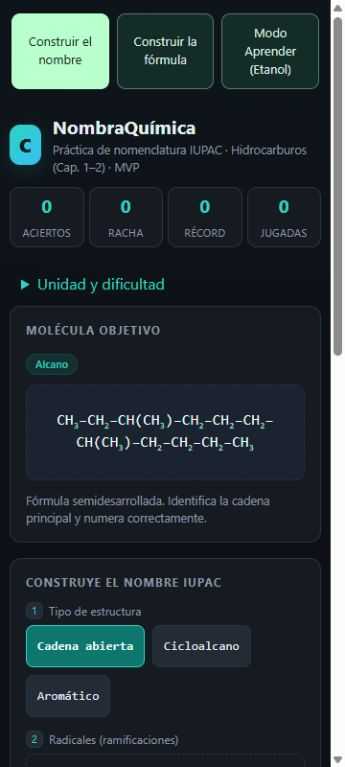
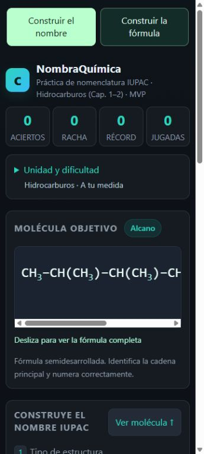
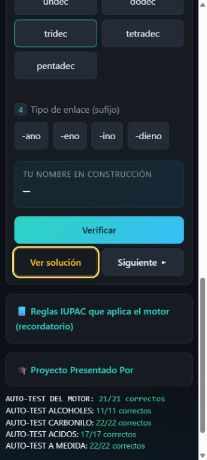
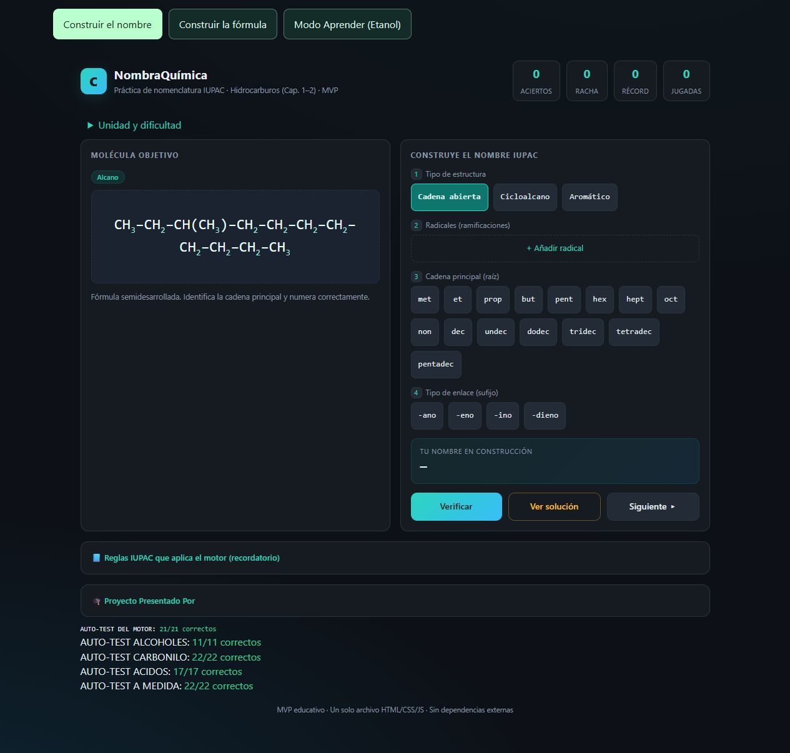
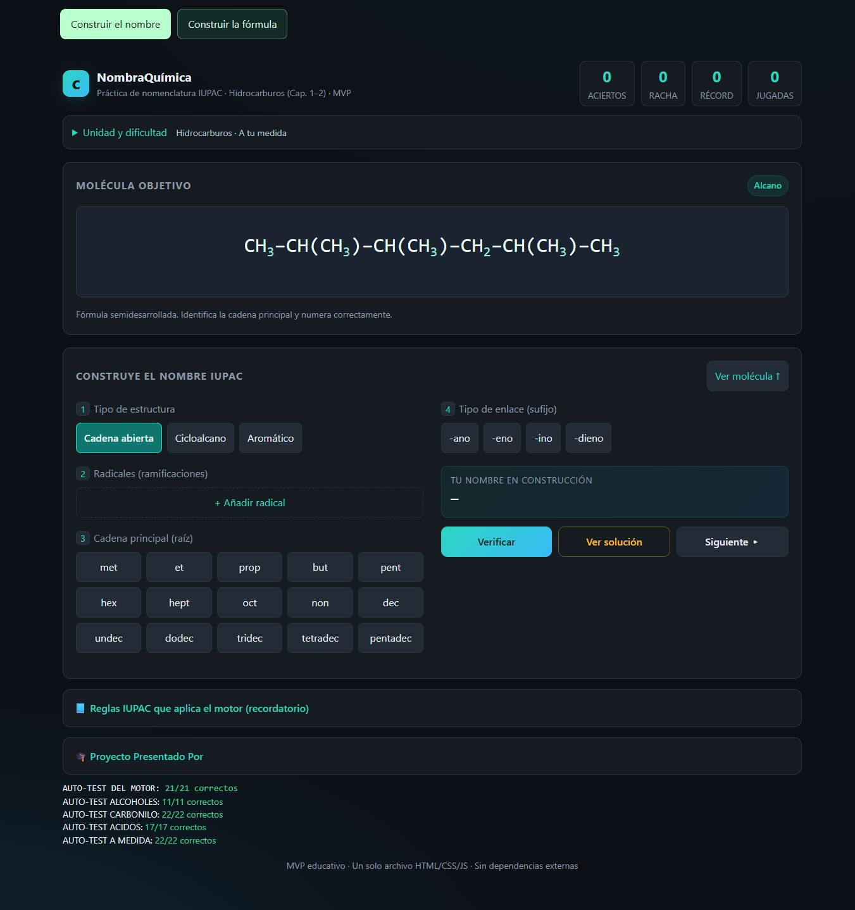

# Comparación de la lectura del modo de nombres

Capturas de `main` con PR #10 integrado y de esta modificación. Los ejemplos son ejercicios aleatorios de alcanos con complejidad alta; las imágenes comparan la distribución, no la respuesta de un mismo ejercicio.

## Teléfono: 360 × 800

| Antes | Después |
|---|---|
|  |  |

La fórmula nueva conserva 24 px y se recorre dentro de su propio recuadro. Los ajustes empiezan plegados y muestran la configuración activa.

## Computadora: 1366 × 900

Capturas de página completa: molécula y constructor arriba/abajo, con dos columnas dentro del constructor nuevo.

| Antes | Después |
|---|---|
|  |  |

## Comprobaciones

- 61 pruebas automatizadas aprobadas: las 50 anteriores y 11 de navegación, foco, preferencias y actualización del visor. Incluyen las 93 comprobaciones químicas originales y 600 objetivos generados de forma reproducible.
- Revisión en navegador a 320, 360 y 412 px; 640 × 360; 1024 y 1366 px. Cadenas con ramificaciones, anillos de 320 px y ajustes abiertos sin desplazamiento horizontal de la página ni controles recortados.
- Fórmula de 24/32 px sin saltos de línea. El inicio de las cadenas largas queda visible y el resto es alcanzable por desplazamiento; la indicación aparece solo cuando hay desbordamiento.
- Abrir/cerrar ajustes conserva molécula, respuesta y puntuación. Cambiar de modo conserva la selección y el ejercicio propio; resolver metano en el constructor incrementa solo su marcador.
- `Ver molécula` desplaza al objetivo y enfoca el visor; las flechas permiten recorrerlo con teclado.
- El motor de nombres y los módulos del constructor químico permanecen iguales a `main` (normalizando saltos de línea). No quedan el prototipo Aprender, sus fichas, datos, animaciones ni controladores en el juego.

Estas capturas y mediciones corresponden al navegador de escritorio con tamaños de pantalla ajustados. No sustituyen una prueba nueva en un teléfono físico ni una comprobación del zoom del navegador móvil.
